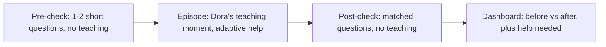

# Learning progress and storage plan

Prepared November 14, 2026 by the dashboard and persistence owner. This builds on [implementation-handoff.md](./implementation-handoff.md) and [model-pipeline-implementation-plan.md](./model-pipeline-implementation-plan.md). The handoff stays authoritative for product scope and ownership, and the pipeline plan stays authoritative for the turn contract and `PipelineStore`. This document is a plan. Nothing in it has been built yet.

## 1. What this workstream covers

The handoff gives the dashboard teammate "persistent storage implementation, read interfaces, and dashboard presentation." This plan adds one product idea to that: **measure the child before and after the show, so the dashboard can show progress instead of only a log of one conversation.**

| Area | Owned here | Not owned here |
| --- | --- | --- |
| Storage | The durable `PipelineStore` adapter, the schema, and the read queries | What the pipeline writes into each record (Luka) |
| Before/after check | The data model, how results are compared, and what the dashboard claims | Who asks the questions on screen and when (cartoon teammate), and how Luna responds during a check (Luka) |
| Dashboard | Parent-facing UI and the progress view | The `/dev/pipeline` developer page (Luka) |

The before/after check changes scope that other teammates own, so section 7 lists what each of them has to agree to.

## 2. The learning flow



- **Pre-check (before the show).** The child answers one or two short questions on the scene's learning objective. Nothing is taught and no right answer is revealed. The answer is recorded as a starting point.
- **Episode.** This is the existing teaching moment from the handoff, with no changes.
- **Post-check (after the show).** The same kind of questions, using **matched items rather than the identical item**. Example: the pre-check asks for 3 apples, the post-check asks for 4 stars. That way a correct post-check answer isn't just the child remembering what was said a minute earlier.
- **Dashboard.** Compares the pre-check and post-check on the same objective and shows how much help the child needed during the episode.

All three phases happen in **one session**. This keeps the handoff's rule that no second session is demonstrated.

## 3. What the dashboard is allowed to claim

The handoff rules out claiming mastery from one interaction. Progress claims follow the same limit.

| Observed | Dashboard says | Never says |
| --- | --- | --- |
| Pre-check incorrect, post-check correct | "Got it wrong before the episode, got a similar question right after" | "Learned counting" or "Mastered" |
| Pre-check correct, post-check correct | "Already answered correctly before the episode" | "Improved" |
| Pre-check correct, post-check incorrect | "Answered correctly before, missed the similar question after" | Anything about regression or ability |
| Either answer unclear or off-topic | "Couldn't compare: an answer wasn't clear" | A guessed outcome |
| Episode turns | "Needed 2 hints, then answered correctly" (Luna's parent summary) | A score |

One or two items per phase is a snapshot, not a test. The dashboard should show the questions the child was asked next to each result, so a parent can judge for themselves.

## 4. Data model

The model extends the records in pipeline plan section 9 instead of replacing them. Field names are proposals until they're agreed with Luka.

### Additions to the scene configuration (authored by the cartoon teammate)

```ts
type CheckItem = {
  questionId: string;
  text: string;
  answerGuide: string;      // stays server-side, like QuestionContext
  matchedWith: string | null; // the pre-check item this post-check item parallels
};

type SceneConfig = {
  // ...existing fields from pipeline plan section 3
  preCheck: CheckItem[];    // 1-2 items
  postCheck: CheckItem[];   // same count, each matchedWith a preCheck item
};
```

### Addition to each interaction record

```ts
type Phase = "pre_check" | "episode" | "post_check";

type InteractionRecord = {
  // ...existing fields from pipeline plan section 9
  phase: Phase;
};
```

The existing `answerStatus` values (`correct | incorrect | unclear | off_topic | not_assessed`) are reused as they are. Check items need no new assessment type.

### Tables

These assume a relational store. The storage choice is still open (section 6).

| Table | Key columns | Notes |
| --- | --- | --- |
| `learners` | `learner_id`, `display_label`, `created_at` | A pseudonymous label only ("Learner A"). No real name, birthdate or photo. Optional for the demo. |
| `sessions` | `session_id`, `learner_id` (nullable), `scene_id`, `objective_id`, `scene_snapshot` (JSON), `turn_number`, `active_question` (JSON), `assistance_provided`, `latest_parent_summary`, `created_at` | Matches `SessionRecord` and `SessionSnapshot`. `turn_number` is the expected-version check for `commitTurn`. |
| `interactions` | `interaction_id` (unique), `session_id`, `turn_number`, `phase`, `question_id`, `question_text`, `answer_guide`, `transcript`, `response_type`, `response_text`, `answer_status`, `evidence`, `possible_misconception`, `assistance_before`, `assistance_in_response`, `parent_summary`, `turn_response` (JSON, for replay), `completed_at` | Unique on (`session_id`, `turn_number`). No audio column, ever. |
| `interaction_diagnostics` | `interaction_id`, `luna_draft` (JSON), model IDs, prompt revision, timings | Kept apart so parent-facing queries never touch drafts. Pipeline plan section 9 allows this split. |

`commitTurn` runs as one transaction. It first looks up `interaction_id` and returns the stored record on a duplicate. It then checks `sessions.turn_number = expectedTurnNumber`. It inserts the interaction (and its diagnostics), then updates the session's active question, assistance state, turn number and latest non-null parent summary. This is the behavior pipeline plan section 9 asks for.

## 5. Read interface for the dashboard

```ts
interface ProgressReader {
  getSessionProgress(sessionId: string): Promise<SessionProgress | null>;
  listSessions(learnerId: string): Promise<SessionSummary[]>; // later, see section 8
}

type ItemComparison = {
  objectiveId: string;
  pre: { questionText: string; transcript: string; status: AnswerStatus } | null;
  post: { questionText: string; transcript: string; status: AnswerStatus } | null;
  outcome: "wrong_then_right" | "right_both" | "right_then_wrong"
         | "wrong_both" | "not_comparable" | "incomplete";
};

type SessionProgress = {
  sessionId: string;
  objective: string;
  comparisons: ItemComparison[];   // one per matched pre/post pair
  episode: {
    turns: number;
    hintsGiven: number;            // count of assistance_in_response
    finalStatus: AnswerStatus | null;
    parentSummary: string | null;
  };
};
```

`outcome` is worked out by a plain function from the two statuses, not by a model. `unclear`, `off_topic` or `not_assessed` on either side gives `not_comparable`. A missing post-check gives `incomplete`. Section 3 maps each outcome to the wording the dashboard shows.

## 6. Storage decision

**Decision: SQL, on managed Postgres, with Drizzle ORM.** Pipeline plan section 9 says the pipeline uses whatever durable store the dashboard teammate supplies. This is that store.

| Choice | Why |
| --- | --- |
| Postgres | `commitTurn` needs a transaction with a unique constraint and a version check, which relational databases do directly. JSON columns hold the scene snapshot, the replay `TurnResponse` and the Luna draft. |
| Managed and serverless (Neon or similar; added through the Vercel Marketplace if the team deploys there) | It works the same from every laptop and from a serverless deployment. The free tier is enough for a demo. A separate dev branch keeps test data out of the demo database. |
| Drizzle ORM | The schema is written in TypeScript next to the Zod contracts. Migrations are plain SQL. It adds no separate runtime service. |

How it plugs in:
- `apps/web/server/storage/postgres.ts` implements `PipelineStore` and `ProgressReader`.
- `PIPELINE_STORE=postgres` selects it, and `DATABASE_URL` is read only on the server.
- Luka's `memory` adapter stays for unit tests.

Fallback: if the team decides to demo from a single machine with no deployment, use the same Drizzle schema on a SQLite file. Deployment is still not chosen, so confirm the host before creating the production database.

## 7. What needs agreement from teammates

| With | Decision | Why it's theirs |
| --- | --- | --- |
| Luka | Add `phase` to records, and add `preCheck` and `postCheck` to `SceneConfig` | Luka owns the shared contracts |
| Luka | **During a check, Luna gives a neutral acknowledgment ("Thanks!") with no hints, no correction and no follow-up question.** It still returns an assessment | If the pre-check teaches, the before/after comparison means nothing |
| Luka | Starting a post-check: either a new session-level call or the controller submitting against a `postCheck` question ID | It affects the turn and session routes |
| Cartoon teammate | Who asks the check questions (Dora, or a plain on-screen prompt), and when the check starts and ends | They own turn coordination and episode progression |
| Cartoon teammate | Writing the matched check items for the chosen objective | They author scene content, and the objective isn't chosen yet |
| Whole team | **Time.** Two check questions at about 10 seconds each push hard against the two-minute demo cap | Options: one question per phase, or run the pre-check before the judge arrives and show its stored result |

## 8. Demo additions

These are in scope for the hackathon, in priority order.

1. **Live dashboard during the demo.** The parent view polls `getSessionProgress` about once a second and shows the judge's answer, the outcome and the parent summary as soon as the pipeline commits them. Show it side by side with the cartoon. No websockets.
2. **Demo reset and fallback.** Add a development-only "reset demo" action that starts a clean session for each judge. Also seed one completed session, visibly labeled "Sample data." The dashboard can show it if the microphone, transcription or Luna fails on stage.
3. **Possible misconception, worded tentatively.** Show `possibleMisconception` from the stored assessment as "This answer *might* mean…", never as a diagnosis. Hide it when it's null.
4. **Shared sample files on day one.** Commit synthetic `InteractionRecord` and `SessionProgress` JSON in `apps/web/lib/contracts/fixtures/`. Then the dashboard UI and the pipeline can each be built and tested without waiting for the other.
5. **A pre-written next step for parents.** Write one short at-home suggestion per objective and outcome (for example, "Try counting toys together at bedtime"), and store it in the scene configuration. Choose it with the `outcome` function. Don't make a model call for it.
6. **A private parent view.** Gate the dashboard behind a simple access code from an environment variable, and add a delete-session action. Accounts are out of scope.

Not added: accounts and logins, charts across sessions, scores or percentages, and generated summaries beyond Luna's existing parent summary.

## 9. Later (not in the demo)

- **Progress across sessions.** `listSessions(learnerId)` plus a per-objective trend. The schema already allows it through `learner_id`. The handoff rules out demonstrating a second session, so this isn't built for the hackathon.
- **Sample data.** If the dashboard shows past sessions to illustrate the idea, they have to be seeded synthetic records that are visibly labeled "Sample data." They can't be presented as a real child's history.

## 10. Privacy

- No raw audio is stored anywhere. The handoff and the pipeline plan both say so.
- Transcripts of children's speech are personal data. Use pseudonymous learner labels and synthetic or team-member voices for every demo and test. Never record a real child.
- Parent-facing queries read only `interactions` and `sessions`, never `interaction_diagnostics`.
- Before any real-child use after the hackathon, get advice on children's privacy law (for example COPPA in the US) and on the transcription provider's retention settings.

## 11. Build order

1. Agree on the section 7 contract changes with Luka. Start with `phase` and the rule that checks never teach.
2. Implement the `PipelineStore` adapter against the schema in section 4, running Luka's memory-adapter tests against it.
3. Write the `outcome` function and its unit tests: each status pair gives the expected outcome.
4. Build `getSessionProgress` and test it on synthetic sessions: wrong→right, right→right, unclear, and a missing post-check.
5. Build the parent dashboard view. It shows the before and after questions with the child's transcripts, the outcome wording from section 3, and the episode summary.
6. Once deployment is chosen, prove that a saved record is still visible after a restart. That's the milestone the pipeline plan says is blocked on this work.
