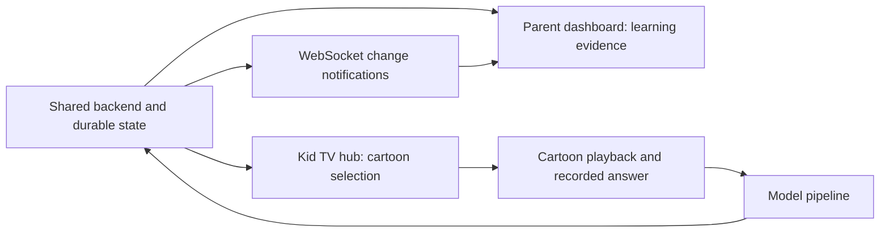

# Learning progress and storage plan

Prepared November 14, 2026 by the dashboard and persistence owner. This builds on [implementation-handoff.md](./implementation-handoff.md) and [model-pipeline-implementation-plan.md](./model-pipeline-implementation-plan.md). The handoff stays authoritative for product scope and ownership, and the pipeline plan stays authoritative for the turn contract and `PipelineStore`. This document is a plan. Nothing in it has been built yet.

## 1. What this workstream covers

The handoff gives the dashboard teammate persistent storage implementation, read interfaces, and dashboard presentation. The planned product has two connected experiences: a kid-facing TV hub for choosing cartoons, and a parent dashboard for evidence from the episode's adaptive teaching conversation, with proposed learning-preference controls owned by that teammate.

**Agreed scope: pre/post learning checks are future work, mentioned in the pitch only. Do not scaffold them.** No check-item schemas, phase fields, check modes, phase-transition endpoints, comparison functions, placeholder UI, migrations, or check fixtures are required for this demo.

| Area | Owned here | Not owned here |
| --- | --- | --- |
| Storage | The durable `PipelineStore` adapter, schema, and read queries | What the pipeline writes into each record (Luka) |
| Parent dashboard | Session evidence and the design/scope of proposed learning-preference controls | The kid TV hub design (separate teammate) and `/dev/pipeline` developer page (Luka) |
| Question reasoning | None | Prepared scene content comes from the scene owner; generated dialogue, follow-up questions, and assessment belong to Luka's pipeline |

The cartoon controller handles recording, playback, and episode progression. It does not choose pedagogical questions or assess answers.

## 2. The implemented learning flow



The kid TV hub presents cartoons as channels or show tiles, such as Dora and Bluey. Its detailed layout and interaction design belong to a separate teammate. Only prepared, supported content should launch an interactive session; multiple tiles do not imply multiple implemented learning pipelines. The initial working demo still uses one prepared scene/objective.

The parent dashboard retains the actual questions, transcripts, assessments, assistance evidence, and parent summary. Its owner may present learning preferences such as “I want my child to learn math.” Whether those controls actually affect playback or the pipeline in this demo is that teammate's decision, not a requirement of Luka's current work. The pipeline uses its prepared scene/objective without depending on functional parent controls.

### What updates live

| Saved change | Receiving view | Visible effect |
| --- | --- | --- |
| A child's interaction completes and is committed | Parent dashboard | Refresh the transcript, assessment, assistance evidence, and summary, whether the answer is correct, incorrect, or unclear. |
| Parent changes a learning preference, if its owner implements this | Kid TV hub/pipeline integration, as agreed separately | Not required or assumed functional for this demo; define the contract with that owner only if taken on. |

There is no need to send a reward to the kid view merely because the parent dashboard received a new assessment. Rewards are not an implied feature of the live connection.

### Connection and state rules

- Both views connect to a shared backend/realtime service, not directly to each other's browser. Two views can live in the same Next.js app; two separate deployments are not required.
- Persist changes first, then publish WebSocket notifications. The database remains authoritative. Notifications identify which state changed; recipients fetch their authorized current state through read endpoints.
- Keep session creation and recorded-audio uploads on the existing HTTP path. WebSockets provide live update notifications rather than replacing transcription or model calls.
- After `commitTurn` succeeds, publish a session update carrying its session ID, interaction ID, and turn number to the authorized parent view. Do not broadcast raw model drafts, private answer guides, or audio. Parent-setting events are not part of the required current contract.
- Load current state on initial connection and reconnect. Ignore duplicate/older notifications and prevent older read responses from overwriting newer state. A notification failure must not roll back a committed interaction or cause the model turn to run again; a refresh/resync reads the saved result. Include a lightweight periodic resync fallback so a missed event is eventually recovered even if the socket remains connected.
- Scope access separately for parent controls/evidence and kid playback state. A session ID or socket channel name alone is not authorization. A paired demo context can keep setup small; the team must agree how the two views are paired before wiring subscriptions.
- Choose a socket-capable backend or managed realtime service alongside deployment. Do not assume adding an HTTP route provides a persistent WebSocket server. Realtime transport ownership is a team integration assignment, not additional model reasoning work for Luka.

### Parent-control scope belongs to its owner

Parent-to-kid learning-preference functionality is not assumed real in the demo. The parent-dashboard teammate decides its design and whether to implement it. Do not add parent-control APIs, scheduling, allow/block enforcement, pause rules, or settings subscriptions as prerequisites for Luka's pipeline. If the owner later implements objective selection, agree its interface then. Keep the current session's scene snapshot fixed.

Pre/post checks remain future-work mentions only. The two-minute demo cap is unchanged.

## 3. What the dashboard is allowed to claim

| Observed in committed records | Dashboard wording | Avoid |
| --- | --- | --- |
| Correct answer with `assistanceBeforeAnswer = false` | "Answered correctly before assistance was recorded" | Mastery or a claim that the episode caused learning |
| Correct answer with `assistanceBeforeAnswer = true` | "Answered correctly after assistance" | "Needed two hints" or counting this as an independent post-test |
| Incorrect answer | "This answer was assessed as incorrect" | Claims about ability or regression |
| Unclear, off-topic, or not-assessed answer | Display that status explicitly | Treating it as incorrect or guessing an outcome |
| Responses with `assistance_in_response = true` | "Responses with assistance" | Calling every assisted response a hint |

`assistance_in_response` includes hints, explanations, and answer reveals. Its count is not a hint count. Records establish selected responses, not verified playback or that the child heard them. Parent summaries must follow the same limits and remain model judgments. Show question text and the corresponding transcript beside each assessment so the evidence is inspectable.

## 4. Data model

Use the existing scene, question, assessment, and interaction contracts from pipeline plan sections 3 and 9. There are no pre/post additions to `SceneConfig` or `InteractionRecord`.

### Tables

| Table | Key columns | Notes |
| --- | --- | --- |
| `learners` | `learner_id`, `display_label`, `created_at` | Optional for the demo; a pseudonymous label only. |
| `sessions` | `session_id`, `learner_id` (nullable), `scene_id`, `objective_id`, `scene_snapshot` (JSON), `turn_number`, `active_question` (JSON), `assistance_provided`, `latest_parent_summary`, `created_at` | Matches `SessionRecord` and `SessionSnapshot`. `turn_number` is the expected-version check for `commitTurn`. |
| `interactions` | `interaction_id` (unique), `session_id`, `turn_number`, `question_id`, `question_text`, `answer_guide`, `transcript`, `response_type`, `response_text`, `next_question` (nullable JSON), `answer_status`, `evidence`, `possible_misconception`, `assistance_before`, `assistance_in_response`, `parent_summary`, `turn_response` (JSON), `completed_at` | Unique on (`session_id`, `turn_number`). No audio column. |
| `interaction_diagnostics` | `interaction_id`, `luna_draft` (JSON), model IDs, prompt revision, timings | Kept apart so parent-facing queries never touch drafts. |

`next_question` stores the full next active question: ID, text, and private answer guide, or null. It is distinct from the public question in `turn_response`, which omits the guide. Persist it on every interaction so later session updates do not erase that turn's context. Public readers must omit private guides.

`commitTurn` runs as one transaction. It looks up a duplicate by both session ID and interaction ID before applying the expected-turn check. A matching duplicate returns its stored record; an interaction ID belonging to another session must never replay that session's data. A globally unique ID collision across sessions is rejected.

For a new interaction, atomically verify `sessions.turn_number = expectedTurnNumber`, insert the interaction and diagnostics, and update the session's active question, assistance state, turn number, and latest non-null parent summary from the record. A plain read followed by an unconditional update is insufficient: use a conditional update or row lock within the transaction. Concurrent duplicates resolve to the existing committed response; distinct stale requests fail without returning their generated speech. Preserve the exact public `turn_response` for retries.

## 5. Read interface for the dashboard

```ts
interface ProgressReader {
  getSessionProgress(sessionId: string): Promise<SessionProgress | null>;
}

type SessionProgress = {
  sessionId: string;
  objective: string;
  interactions: Array<{
    interactionId: string;
    turnNumber: number;
    questionText: string;
    transcript: string;
    responseText: string;
    responseType: "teaching" | "clarification";
    assessment: LearningAssessment;
    assistanceInResponse: boolean;
  }>;
  episode: {
    turns: number;
    responsesWithAssistance: number;
    finalStatus: LearningAssessment["answerStatus"] | null;
    parentSummary: string | null;
  };
};
```

Reuse `LearningAssessment` from the shared contracts. Return interactions ordered by turn number. `turns` counts committed interactions; `responsesWithAssistance` counts their true `assistance_in_response` values. `finalStatus` is the latest committed interaction's status, including `not_assessed`; it is null if there are no interactions. Do not silently substitute an earlier correct answer. `parentSummary` is the latest non-null stored summary, which an empty-transcript turn does not erase.

There is no before/after comparison or comparison-outcome enum. A synthetic example with an incorrect answer followed by a correct answer describes the episode conversation only.

## 6. Storage decision

**Decision: SQL, on managed Postgres, with Drizzle ORM.** Pipeline plan section 9 says the pipeline uses whatever durable store the dashboard teammate supplies. This is that store.

| Choice | Why |
| --- | --- |
| Postgres | `commitTurn` needs a transaction with a unique constraint and a version check, which relational databases do directly. JSON columns hold the scene snapshot, the replay `TurnResponse` and the Luna draft. |
| Managed and serverless (Neon or similar; added through the Vercel Marketplace if the team deploys there) | It works the same from every laptop and from a serverless deployment. The free tier is enough for a demo. A separate dev branch keeps test data out of the demo database. |
| Drizzle ORM | The schema is written in TypeScript next to the Zod contracts. Migrations are plain SQL. It adds no separate runtime service. |

How it plugs in:
- `apps/web/server/storage/postgres.ts` implements `PipelineStore` and `ProgressReader`.
- `PIPELINE_STORE=postgres` selects it, and `DATABASE_URL` is read only on the server.
- Luka's `memory` adapter stays for unit tests.

Fallback: if the team decides to demo from a single machine with no deployment, use the same Drizzle schema on a SQLite file. Deployment is still not chosen, so confirm the host before creating the production database.

### Implementation status (Nov 14)

Built on the `parent-dashboard` branch in `apps/web/server/storage/`. All 11 tests in `postgres.test.ts` pass against PGlite. It hasn't been run against a hosted database yet. Differences from the table above:

- `sessions` adds `is_sample` (boolean, default false), which drives the dashboard's "Sample data" badge.
- `interactions` uses the primary key (`session_id`, `interaction_id`) instead of a globally unique `interaction_id`, so a duplicate check never matches a record from another session. (`session_id`, `turn_number`) is still unique.
- `interactions` also stores `scene_id` and `objective_id` per record, as the identity group in pipeline plan §9 requires.
- `interaction_diagnostics` is keyed and cascades on (`session_id`, `interaction_id`).

**Host: Tiger Cloud (Tiger Data's managed Postgres)**, chosen for HackPrinceton's MLH "Best Use of Tiger Data" prize. The migration was applied on Nov 14, and a live round trip through the adapter passed: commit, replay and parent read.

To connect: get the connection string privately from the dashboard owner (never commit it). Put `DATABASE_URL="..."` and `PIPELINE_STORE=postgres` in `apps/web/.env.local`, then run `npm run db:migrate -w web`. `drizzle.config.ts` loads `.env.local` automatically.

Possible extra for the prize: a TimescaleDB hypertable for a separate time-ordered learning-event log. Don't convert `interactions`, because hypertables restrict primary keys and that would break duplicate-safe commits.

## 7. Integration agreement

| With | Agreement | Boundary |
| --- | --- | --- |
| Luka | Implement the existing `PipelineStore` and share `InteractionRecord` / `SessionProgress` fixtures | Luka supplies completed evidence; dashboard owner supplies durable storage and reads |
| Luka | Store the full private `next_question` and preserve the public response for replay | Question context stays consistent without exposing answer guides |
| Luka | Use assistance wording from section 3 in summaries and dashboard metrics | No unsupported hint counts or mastery claims |
| Cartoon teammate | Consume pipeline speech/question metadata and coordinate recording, playback, and episode progression | No pedagogical reasoning or check flow in the controller |
| Kid UI owner | Build the TV hub and connect its prepared show selection to playback | Detailed kid UI design stays with that teammate |
| Whole team | Assign realtime ownership, select socket hosting, and agree view pairing; parent-control functionality stays with its owner | Notifications follow durable writes; no learning reasoning in the controller |
| Whole team | Confirm hosting and database provider, then rehearse the existing two-minute interaction | No extra pre/post questions in the demo |

## 8. Demo additions

These are in scope for the hackathon, in priority order.

1. **Two live views during the demo.** Show the kid TV hub/player and parent dashboard. WebSocket notifications trigger authorized state refreshes after committed interactions, as specified in section 2. This supersedes the earlier once-per-second polling-only plan. Retain resync for missed notifications.
2. **Demo reset and fallback.** Add a development-only "reset demo" action that starts a clean session for each judge. Also seed one completed session, visibly labeled "Sample data." The dashboard can show it if the microphone, transcription or Luna fails on stage.
3. **Possible misconception, worded tentatively.** Show `possibleMisconception` from the stored assessment as "This answer *might* mean…", never as a diagnosis. Hide it when it's null.
4. **Shared sample files on day one.** Commit synthetic `InteractionRecord` and `SessionProgress` JSON in `apps/web/lib/contracts/fixtures/`. Then the dashboard UI and the pipeline can each be built and tested without waiting for the other.
5. **A pre-written next step for parents.** Write one short at-home suggestion per objective (for example, "Try counting toys together at bedtime"). Keep it as dashboard-authored content keyed by objective ID. No comparison function, scene-contract extension, or extra model call is needed.
6. **A private parent view.** Gate the dashboard behind a simple access code from an environment variable, and add a delete-session action. Accounts are out of scope.

Not added: accounts and logins, charts across sessions, scores or percentages, and generated summaries beyond Luna's existing parent summary.

## 9. Parent dashboard foundation

The dashboard owner builds the technical foundation for the parent view: styling setup, routes, data wiring and UI states. **Visual design (layout, colors, type, illustration) is not part of this work.** The foundation exposes design tokens and unstyled-but-structured components so the design can be applied in one place later.

### Tailwind setup (Tailwind CSS v4): done

**Status: done** on the `parent-dashboard` branch (Nov 14). Tailwind 4.3.5 is set up, and build, lint and type check pass. The steps below are kept for reference.

1. Run this from the repo root: `npm install -w web tailwindcss @tailwindcss/postcss postcss`
2. Add `apps/web/postcss.config.mjs`:
   ```js
   export default { plugins: { "@tailwindcss/postcss": {} } };
   ```
3. Replace the top of `apps/web/app/globals.css`:
   ```css
   @import "tailwindcss";
   @source "../../../packages/ui/src";   /* scan shared components too */

   @theme {
     --color-background: var(--background);
     --color-foreground: var(--foreground);
     --font-sans: var(--font-geist-sans);
     --font-mono: var(--font-geist-mono);
     /* design tokens go here; placeholders until the design lands */
   }
   ```
   Keep the existing `:root` variables and the dark-mode block. Delete the starter-only rules after the starter page is removed.
4. Check the Tailwind and Next.js versions actually installed, and follow their docs if they differ from this. `AGENTS.md` also requires reading the installed Turbo docs before changing Turbo config. This setup doesn't need any Turbo changes.

Only `web` gets Tailwind. `apps/docs` stays as it is.

### Routes and files

```text
apps/web/app/parent/
  layout.tsx                         Access-code gate (server), page shell
  [sessionId]/page.tsx               Server component: first read via ProgressReader
  [sessionId]/live-progress.tsx      Client component: subscribes, refetches on change
  _components/
    session-header.tsx               Objective, sample-data badge
    interaction-card.tsx             Question, transcript, response, assessment
    assessment-label.tsx             Section 3 wording only
    misconception-note.tsx           "This answer might mean…", hidden when null
    parent-summary.tsx               Latest non-null summary
    next-step.tsx                    Pre-written suggestion by objective ID
    states.tsx                       Loading, empty, error
apps/web/app/api/parent/sessions/[sessionId]/progress/route.ts
apps/web/lib/parent/wording.ts       answerStatus/assistance → section 3 text
apps/web/lib/parent/next-steps.ts    objectiveId → suggestion
apps/web/lib/parent/subscribe.ts     subscribeToSession(): wraps the agreed realtime transport
```

Dashboard components stay in `apps/web`. `packages/ui` is shared with `docs`, so move something there only if a second app needs it.

### Data wiring

- The server page calls `getSessionProgress` directly for the first render.
- The client component calls `subscribeToSession(sessionId, onChange)`. Each change notification (session ID, interaction ID, turn number) triggers a refetch of `GET /api/parent/sessions/{sessionId}/progress`. Notifications never carry evidence themselves, as section 2 requires.
- Ignore notifications whose turn number is at or below what's on screen, and drop any refetch response that's older than the one already shown.
- Refetch on connect and reconnect, plus a slow resync every ~10 seconds so a missed event still shows up.
- Realtime ownership and hosting aren't assigned yet (section 7). `subscribe.ts` is the only file that knows the transport. Until it exists, its stub just runs the resync on a short timer, so the dashboard works end to end against fixtures and the memory adapter.
- The route returns `SessionProgress` only. It must never include `answerGuide`, `next_question` guides or diagnostics. Add a test that fails if a guide appears in the response.
- Show all wording through `wording.ts` so section 3's claim limits live in one place, with unit tests for every `answerStatus` value.
- Build against the section 8 fixtures first. The fixtures, the memory adapter and the Postgres adapter all go through the same `ProgressReader`.

### UI states the foundation must cover

| State | Shows |
| --- | --- |
| Loading | Skeleton, with no fake numbers |
| No interactions yet | "Waiting for the first answer" |
| Live | Interactions ordered by turn; the newest one appears without a page reload |
| Sample data | A persistent "Sample data" badge, driven by the session record and not by the URL |
| Error / store down / socket lost | A plain message; it reconnects and resyncs on its own |
| Wrong or missing access code | Code entry form, no session data |

### Foundation done when

- Tailwind classes render in `web`, and `npm run build`, `lint` and `check-types` pass from the root.
- `/parent/{sampleSessionId}` renders the fixture session in every state above.
- A new committed interaction shows up within about two seconds with no page reload.
- No private field reaches the browser, and the test proves it.
- A designer can restyle everything by editing `@theme` tokens and component class names, with no data or logic changes.

## 10. Future work — mention only

- **Before/after learning checks.** The pitch may say: “We plan to add short checks before and after the episode to compare answers on similar questions.” These checks are not implemented or demonstrated. Do not add types, fields, routes, prompts, fixtures, UI placeholders, or storage scaffolding for them now. Question matching and interpretation will be designed when this feature is actually taken on.
- **Progress across sessions.** A possible later extension, not an implemented read interface or demo claim. No second-session demonstration.
- **Sample data.** Any seeded session illustrates the implemented episode interaction and is visibly labeled “Sample data.” It must not fabricate a before/after feature or real learning history.

## 11. Privacy

- No raw audio is retained in application storage. This does not establish the external transcription provider's retention policy.
- Transcripts of children's speech are personal data. Use pseudonymous learner labels and synthetic or team-member voices for every demo and test. Never record a real child.
- Parent-facing queries read only `interactions` and `sessions`, never `interaction_diagnostics`.
- Before any real-child use after the hackathon, get advice on children's privacy law (for example COPPA in the US) and on the transcription provider's retention settings.

## 12. Build order

1. Share the existing turn/evidence contract and synthetic interaction/session-progress fixtures with Luka. No check-related contract changes.
2. Implement `PipelineStore` against section 4, including full private question context, atomic updates, and session-scoped duplicate handling. Run the store contract tests against the durable adapter.
3. Implement `getSessionProgress` and test empty sessions, correct/incorrect/unclear answers, assistance counts, and preservation of the latest non-null summary.
4. Build the parent dashboard foundation from section 9 (Tailwind, routes, the `subscribeToSession` wrapper, UI states, the wording module) against fixtures, then apply the design once it's ready. Verify private guides and drafts are excluded from public responses.
5. Connect both views through the agreed realtime service. Verify that a committed child interaction refreshes parent evidence, reconnect/missed events resync from storage, and duplicate notifications do not duplicate evidence. The dashboard must read the same committed evidence returned by the pipeline.
6. Prove records survive backend restart and rehearse the two-minute demo. Mention future checks in the pitch only.
