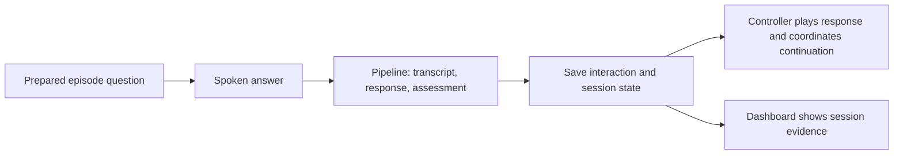

# Learning progress and storage plan

Prepared November 14, 2026 by the dashboard and persistence owner. This builds on [implementation-handoff.md](./implementation-handoff.md) and [model-pipeline-implementation-plan.md](./model-pipeline-implementation-plan.md). The handoff stays authoritative for product scope and ownership, and the pipeline plan stays authoritative for the turn contract and `PipelineStore`. This document is a plan. Nothing in it has been built yet.

## 1. What this workstream covers

The handoff gives the dashboard teammate persistent storage implementation, read interfaces, and dashboard presentation. The implemented scope is evidence from the episode's adaptive teaching conversation.

**Agreed scope: pre/post learning checks are future work, mentioned in the pitch only. Do not scaffold them.** No check-item schemas, phase fields, check modes, phase-transition endpoints, comparison functions, placeholder UI, migrations, or check fixtures are required for this demo.

| Area | Owned here | Not owned here |
| --- | --- | --- |
| Storage | The durable `PipelineStore` adapter, schema, and read queries | What the pipeline writes into each record (Luka) |
| Dashboard | Parent-facing UI and the session evidence view | The `/dev/pipeline` developer page (Luka) |
| Question reasoning | None | Prepared scene content comes from the scene owner; generated dialogue, follow-up questions, and assessment belong to Luka's pipeline |

The cartoon controller handles recording, playback, and episode progression. It does not choose pedagogical questions or assess answers.

## 2. The implemented learning flow



The dashboard displays the actual questions, transcripts, assessments, assistance evidence, and parent summary produced during one teaching conversation. It does not display a separate baseline or post-test result. The existing two-minute demo scope remains unchanged.

## 3. What the dashboard is allowed to claim

| Observed in committed records | Dashboard wording | Avoid |
| --- | --- | --- |
| Correct answer with `assistanceBeforeAnswer = false` | "Answered correctly before assistance was recorded" | Mastery or a claim that the episode caused learning |
| Correct answer with `assistanceBeforeAnswer = true` | "Answered correctly after assistance" | "Needed two hints" or counting this as an independent post-test |
| Incorrect answer | "This answer was assessed as incorrect" | Claims about ability or regression |
| Unclear, off-topic, or not-assessed answer | Display that status explicitly | Treating it as incorrect or guessing an outcome |
| Responses with `assistance_in_response = true` | "Responses with assistance" | Calling every assisted response a hint |

`assistance_in_response` includes hints, explanations, and answer reveals. Its count is not a hint count. Records establish selected responses, not verified playback or that the child heard them. Parent summaries must follow the same limits and remain model judgments. Show question text and the corresponding transcript beside each assessment so the evidence is inspectable.

## 4. Data model

Use the existing scene, question, assessment, and interaction contracts from pipeline plan sections 3 and 9. There are no pre/post additions to `SceneConfig` or `InteractionRecord`.

### Tables

| Table | Key columns | Notes |
| --- | --- | --- |
| `learners` | `learner_id`, `display_label`, `created_at` | Optional for the demo; a pseudonymous label only. |
| `sessions` | `session_id`, `learner_id` (nullable), `scene_id`, `objective_id`, `scene_snapshot` (JSON), `turn_number`, `active_question` (JSON), `assistance_provided`, `latest_parent_summary`, `created_at` | Matches `SessionRecord` and `SessionSnapshot`. `turn_number` is the expected-version check for `commitTurn`. |
| `interactions` | `interaction_id` (unique), `session_id`, `turn_number`, `question_id`, `question_text`, `answer_guide`, `transcript`, `response_type`, `response_text`, `next_question` (nullable JSON), `answer_status`, `evidence`, `possible_misconception`, `assistance_before`, `assistance_in_response`, `parent_summary`, `turn_response` (JSON), `completed_at` | Unique on (`session_id`, `turn_number`). No audio column. |
| `interaction_diagnostics` | `interaction_id`, `luna_draft` (JSON), model IDs, prompt revision, timings | Kept apart so parent-facing queries never touch drafts. |

`next_question` stores the full next active question: ID, text, and private answer guide, or null. It is distinct from the public question in `turn_response`, which omits the guide. Persist it on every interaction so later session updates do not erase that turn's context. Public readers must omit private guides.

`commitTurn` runs as one transaction. It looks up a duplicate by both session ID and interaction ID before applying the expected-turn check. A matching duplicate returns its stored record; an interaction ID belonging to another session must never replay that session's data. A globally unique ID collision across sessions is rejected.

For a new interaction, atomically verify `sessions.turn_number = expectedTurnNumber`, insert the interaction and diagnostics, and update the session's active question, assistance state, turn number, and latest non-null parent summary from the record. A plain read followed by an unconditional update is insufficient: use a conditional update or row lock within the transaction. Concurrent duplicates resolve to the existing committed response; distinct stale requests fail without returning their generated speech. Preserve the exact public `turn_response` for retries.

## 5. Read interface for the dashboard

```ts
interface ProgressReader {
  getSessionProgress(sessionId: string): Promise<SessionProgress | null>;
}

type SessionProgress = {
  sessionId: string;
  objective: string;
  interactions: Array<{
    interactionId: string;
    turnNumber: number;
    questionText: string;
    transcript: string;
    responseText: string;
    responseType: "teaching" | "clarification";
    assessment: LearningAssessment;
    assistanceInResponse: boolean;
  }>;
  episode: {
    turns: number;
    responsesWithAssistance: number;
    finalStatus: LearningAssessment["answerStatus"] | null;
    parentSummary: string | null;
  };
};
```

Reuse `LearningAssessment` from the shared contracts. Return interactions ordered by turn number. `turns` counts committed interactions; `responsesWithAssistance` counts their true `assistance_in_response` values. `finalStatus` is the latest committed interaction's status, including `not_assessed`; it is null if there are no interactions. Do not silently substitute an earlier correct answer. `parentSummary` is the latest non-null stored summary, which an empty-transcript turn does not erase.

There is no before/after comparison or comparison-outcome enum. A synthetic example with an incorrect answer followed by a correct answer describes the episode conversation only.

## 6. Storage decision

**Decision: SQL, on managed Postgres, with Drizzle ORM.** Pipeline plan section 9 says the pipeline uses whatever durable store the dashboard teammate supplies. This is that store.

| Choice | Why |
| --- | --- |
| Postgres | `commitTurn` needs a transaction with a unique constraint and a version check, which relational databases do directly. JSON columns hold the scene snapshot, the replay `TurnResponse` and the Luna draft. |
| Managed and serverless (Neon or similar; added through the Vercel Marketplace if the team deploys there) | It works the same from every laptop and from a serverless deployment. The free tier is enough for a demo. A separate dev branch keeps test data out of the demo database. |
| Drizzle ORM | The schema is written in TypeScript next to the Zod contracts. Migrations are plain SQL. It adds no separate runtime service. |

How it plugs in:
- `apps/web/server/storage/postgres.ts` implements `PipelineStore` and `ProgressReader`.
- `PIPELINE_STORE=postgres` selects it, and `DATABASE_URL` is read only on the server.
- Luka's `memory` adapter stays for unit tests.

Fallback: if the team decides to demo from a single machine with no deployment, use the same Drizzle schema on a SQLite file. Deployment is still not chosen, so confirm the host before creating the production database.

## 7. Integration agreement

| With | Agreement | Boundary |
| --- | --- | --- |
| Luka | Implement the existing `PipelineStore` and share `InteractionRecord` / `SessionProgress` fixtures | Luka supplies completed evidence; dashboard owner supplies durable storage and reads |
| Luka | Store the full private `next_question` and preserve the public response for replay | Question context stays consistent without exposing answer guides |
| Luka | Use assistance wording from section 3 in summaries and dashboard metrics | No unsupported hint counts or mastery claims |
| Cartoon teammate | Consume pipeline speech/question metadata and coordinate recording, playback, and episode progression | No pedagogical reasoning or check flow in the controller |
| Whole team | Confirm hosting and database provider, then rehearse the existing two-minute interaction | No extra pre/post questions in the demo |

## 8. Demo additions

These are in scope for the hackathon, in priority order.

1. **Live dashboard during the demo.** The parent view polls `getSessionProgress` about once a second and shows the judge's answer, its assessment and the parent summary as soon as the pipeline commits them. Show it side by side with the cartoon. No websockets.
2. **Demo reset and fallback.** Add a development-only "reset demo" action that starts a clean session for each judge. Also seed one completed session, visibly labeled "Sample data." The dashboard can show it if the microphone, transcription or Luna fails on stage.
3. **Possible misconception, worded tentatively.** Show `possibleMisconception` from the stored assessment as "This answer *might* mean…", never as a diagnosis. Hide it when it's null.
4. **Shared sample files on day one.** Commit synthetic `InteractionRecord` and `SessionProgress` JSON in `apps/web/lib/contracts/fixtures/`. Then the dashboard UI and the pipeline can each be built and tested without waiting for the other.
5. **A pre-written next step for parents.** Write one short at-home suggestion per objective (for example, "Try counting toys together at bedtime"). Keep it as dashboard-authored content keyed by objective ID. No comparison function, scene-contract extension, or extra model call is needed.
6. **A private parent view.** Gate the dashboard behind a simple access code from an environment variable, and add a delete-session action. Accounts are out of scope.

Not added: accounts and logins, charts across sessions, scores or percentages, and generated summaries beyond Luna's existing parent summary.

## 9. Future work — mention only

- **Before/after learning checks.** The pitch may say: “We plan to add short checks before and after the episode to compare answers on similar questions.” These checks are not implemented or demonstrated. Do not add types, fields, routes, prompts, fixtures, UI placeholders, or storage scaffolding for them now. Question matching and interpretation will be designed when this feature is actually taken on.
- **Progress across sessions.** A possible later extension, not an implemented read interface or demo claim. No second-session demonstration.
- **Sample data.** Any seeded session illustrates the implemented episode interaction and is visibly labeled “Sample data.” It must not fabricate a before/after feature or real learning history.

## 10. Privacy

- No raw audio is retained in application storage. This does not establish the external transcription provider's retention policy.
- Transcripts of children's speech are personal data. Use pseudonymous learner labels and synthetic or team-member voices for every demo and test. Never record a real child.
- Parent-facing queries read only `interactions` and `sessions`, never `interaction_diagnostics`.
- Before any real-child use after the hackathon, get advice on children's privacy law (for example COPPA in the US) and on the transcription provider's retention settings.

## 11. Build order

1. Share the existing turn/evidence contract and synthetic interaction/session-progress fixtures with Luka. No check-related contract changes.
2. Implement `PipelineStore` against section 4, including full private question context, atomic updates, and session-scoped duplicate handling. Run the store contract tests against the durable adapter.
3. Implement `getSessionProgress` and test empty sessions, correct/incorrect/unclear answers, assistance counts, and preservation of the latest non-null summary.
4. Build the parent dashboard around ordered question/answer evidence, tentative assessments, and the session summary. Verify private guides and drafts are excluded from public responses.
5. Connect the live interaction and verify the dashboard reads the same committed evidence returned by the pipeline.
6. Prove records survive backend restart and rehearse the two-minute demo. Mention future checks in the pitch only.
